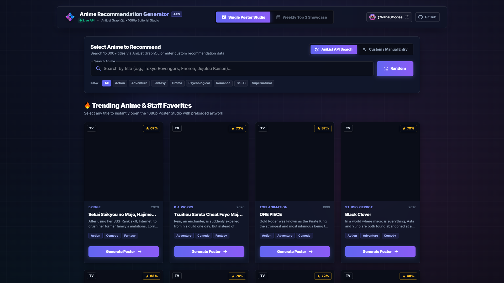
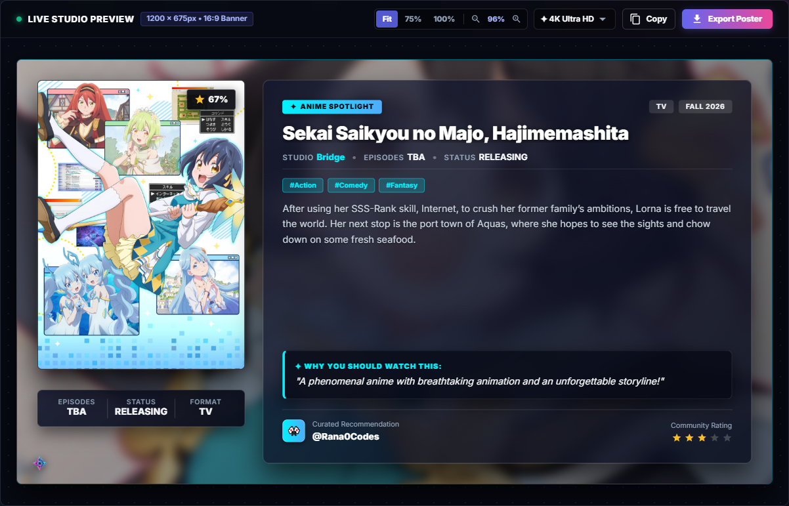
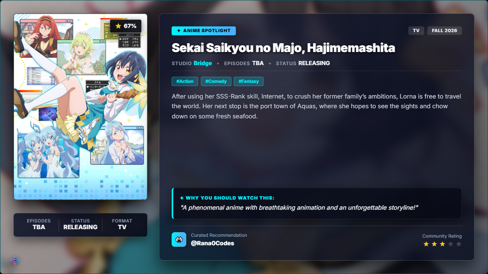
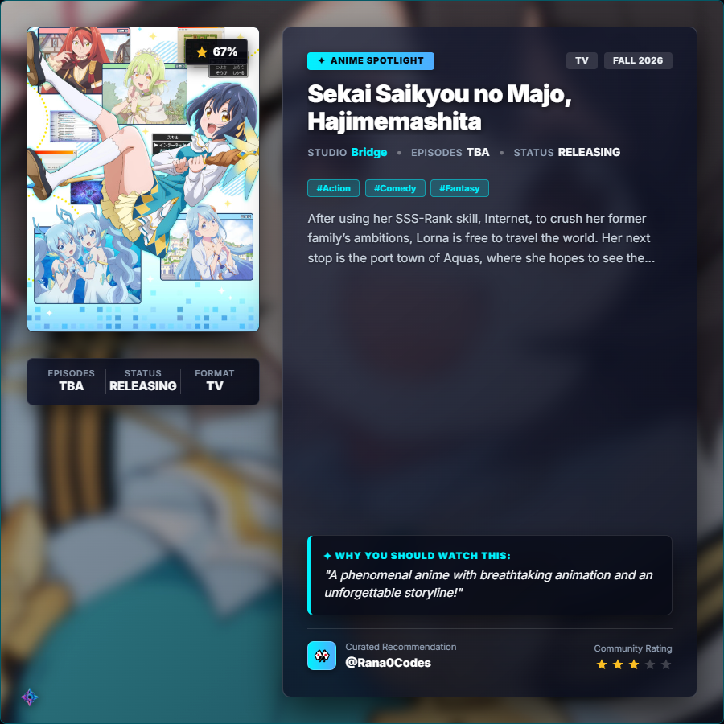
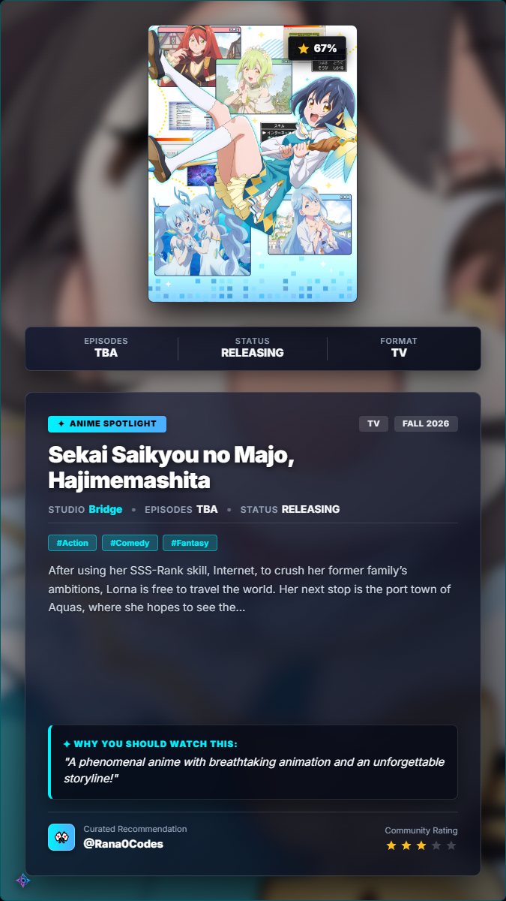
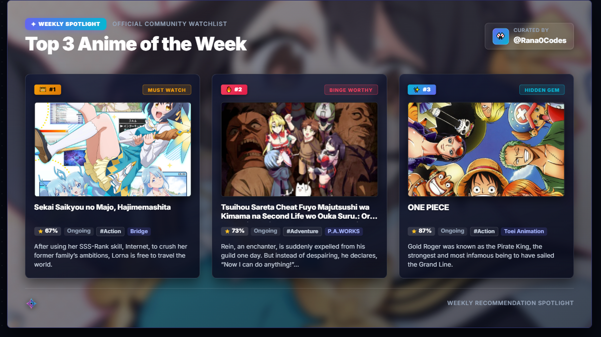

# 🎌 Anime Recommendation Generator (ARG v2.0 PRO)

> **Professional anime recommendation publishing suite designed for content creators. Search trending titles with AniList GraphQL or upload custom indie entries, design curated recommendation cards with responsive themes, and export lossless Full HD & 4K Ultra HD graphics tailored for Twitter/X, Instagram, Discord, and TikTok.**

[](https://anime-recommendation-generator.rana0codes.workers.dev/)
[](https://reactjs.org/)
[](https://mui.com/)
[](https://anilist.co/)
[](LICENSE)

---

## 🌐 Live Demo

The production application is deployed, verified, and publicly accessible:

👉 **[Open Anime Recommendation Generator](https://anime-recommendation-generator.rana0codes.workers.dev/)**

---

## 🖼️ Application Interface & Output Gallery

### 1. Studio Dashboard & Discovery Interface


### 2. Single Anime Studio Canvas Stage


### 3. Publication Formats & Aspect Ratios

| 16:9 Landscape Banner (1920 × 1080 / 3000 × 1688) | 1:1 Square Feed Post (1080 × 1080 / 1800 × 1800) |
| :---: | :---: |
|  |  |
| *Optimized for Twitter/X headers, YouTube Community, & Discord embeds* | *Optimized for Instagram feeds, Threads, & Facebook* |

| 9:16 Vertical Story / Reel (1080 × 1920 / 1350 × 2400) | Weekly Top 3 Showcase (1200 × 675 / 2400 × 1350) |
| :---: | :---: |
|  |  |
| *Optimized for Instagram Stories, TikTok, & YouTube Shorts* | *Unified 3-podium spotlight for weekly seasonal roundups* |

---

## ✨ Features & Capabilities

### 🔍 1. AniList GraphQL Discovery Engine
- **Direct Catalog Integration:** Real-time search against the official AniList GraphQL API (`https://graphql.anilist.co`) with zero API key requirement.
- **Title Matching:** Searches across English, Romaji, and Native Japanese titles.
- **Serendipitous Roulette:** 1-click random discovery filtered across all major genres (Action, Sci-Fi, Psychological, Romance, Fantasy, Mystery, etc.).
- **Rich Metadata Extraction:** Broadcast status, episode counts, release seasons, animation studio credits, genres, community ratings, and high-res cover art.

### 🎨 2. Dual-Resolution Export Pipeline
- **✦ 4K Ultra HD Mode (`2.5x` Pixel Ratio):** Generates true ~300 DPI high-density graphics (e.g. 3000 × 1688 px) for ultra-sharp viewing on retina displays and print assets.
- **HD 1080p Mode (`2.0x` Pixel Ratio):** Rapid high-resolution output (2400 × 1350 px) optimized for social media feeds.
- **Strict Square Export Corners:** Enforces 90-degree square corners (`border-radius: 0px`) during export, eliminating dark alpha transparency halo artifacts.
- **Instant System Clipboard Copy:** 1-click copy directly to your operating system clipboard to paste straight into Discord, Slack, or Twitter/X.

### 🎛️ 3. Studio Preview Stage & Responsive Viewport
- **Auto-Fit Viewport:** Dynamically calculates available container width and auto-scales posters proportionally to fit laptops, tablets, and mobile screens without horizontal scrollbars.
- **Interactive Zoom Toolbar:** Zoom presets (`Fit`, `75%`, `100%`) with fine-grained `+` / `–` controls and live scale readouts.
- **Modern Squircle Architecture:** Crisp, structured geometry across all cards (`8px`–`10px`), inputs/buttons (`6px`), and badges (`4px`).

### 🌈 4. Four Curated Editorial Themes
- 🌌 **Cyberpunk Neon:** Midnight navy backdrop with electric cyan (`#00f2fe`) and neon magenta highlights.
- 🖤 **Dark Onyx:** Minimalist charcoal slate with refined teal borders and subdued frosted glass.
- 🌸 **Sakura Night:** Floral midnight violet with cherry blossom pink accents.
- 🌅 **Sunset Synthwave:** Warm violet-to-amber gradient inspired by 80s retro aesthetics.

### 📅 5. Weekly Top 3 Recommendation Showcase
- Curate a multi-title watchlist into a unified 3-slot showcase graphic:
  - 👑 `#1 MUST WATCH` (Lead priority anime)
  - 🔥 `#2 BINGE WORTHY` (High-engagement series)
  - ✨ `#3 HIDDEN GEM` (Underrated discovery)
- Includes automated random team generation, individual custom ratings, and unified curator signature.

### ✍️ 6. Manual Entry & Custom Asset Mode
- Add unlisted indie animations, upcoming seasonal premieres, custom light novels, or manga.
- **Local File Upload:** Client-side Base64 data conversion for custom cover art and banners, ensuring 100% offline rendering independence.

---

## 🛠️ Technology Stack

| Layer | Technologies |
| :--- | :--- |
| **Frontend Framework** | React 18.2 (Create React App architecture) |
| **Component System** | Material-UI (MUI v5), Emotion styled-components |
| **Typography & Styling** | Inter & Nunito web fonts, Tailwind CSS utility classes |
| **API Protocol** | AniList GraphQL API (`https://graphql.anilist.co`) |
| **Rasterization & Export** | `html-to-image` (SVG foreignObject), `html2canvas` fallback |
| **Serverless Function** | Node.js Serverless Image Proxy (`api/image-proxy.js`) |
| **CI/CD & Deployment** | GitHub Actions (`actions/deploy-pages@v4`), GitHub Pages |

---

## 🚀 Getting Started

### Prerequisites
- **Node.js**: v16.0.0 or higher (v18+ recommended)
- **npm**: v8.0.0 or higher

### Installation & Local Setup

1. **Clone the repository:**
   ```bash
   git clone https://github.com/Rana0Codes/Anime-Recommendation-Generator.git
   cd Anime-Recommendation-Generator
   ```

2. **Install dependencies:**
   ```bash
   npm install --legacy-peer-deps
   ```

3. **Start the local development server:**
   ```bash
   npm start
   ```
   Open [http://localhost:3000](http://localhost:3000) to view the application in your browser.

4. **Compile the production build:**
   ```bash
   npm run build
   ```
   This generates an optimized static bundle in the `build/` directory with relative asset paths configured for GitHub Pages.

---

## 📖 How to Use

1. **Select Recommendation Mode**: Toggle between **Single Recommendation** or **Weekly Top 3** in the top navigation bar.
2. **Search or Enter Anime**:
   - In **AniList Search**: Type any title in the search box, pick from the live suggestions, or click **Random Anime** for instant genre discovery.
   - In **Manual Mode**: Fill in custom metadata (title, episodes, genres, description) and upload local image files.
3. **Customize Design & Content**:
   - Choose your **Aspect Ratio** (`16:9 Banner`, `1:1 Square`, or `9:16 Story`).
   - Select one of the 4 visual **Themes** (Cyberpunk Neon, Dark Onyx, Sakura Night, Sunset Synthwave).
   - Enter your **Curator Handle** (`@YourName`), assign a star rating (1–5 stars), and add personal recommendation notes.
4. **Inspect in Studio Stage**: Use the interactive zoom toolbar (`Fit`, `75%`, `100%`, `+`, `–`) to preview the exact graphic.
5. **Export & Share**:
   - Select resolution (`✦ 4K Ultra HD` or `HD 1080p`).
   - Click **Export Poster** to download a high-res PNG file.
   - Click **Copy** to copy the image directly to your clipboard.

---

## 🚢 Deployment Strategies

### Live Production Deployment (Cloudflare)
- **Status**: Live, verified, and operational.
- **Production URL**: **[`https://anime-recommendation-generator.rana0codes.workers.dev/`](https://anime-recommendation-generator.rana0codes.workers.dev/)**
- **Hosting Engine**: Cloudflare global edge network with instant asset distribution and SSL.

### Alternative Hosting: Vercel (Edge & Serverless Support)
ARG is fully configured for 1-click import on Vercel:
- Includes [`api/image-proxy.js`](api/image-proxy.js) which automatically provisions a serverless reverse proxy on Vercel.
- **Build Command**: `npm run build`
- **Output Directory**: `build`
- **Framework Preset**: Create React App
- Configuration file: [`vercel.json`](vercel.json)

### Alternative Hosting: GitHub Pages
The repository includes an automated GitHub Actions deployment workflow at [`.github/workflows/deploy.yml`](.github/workflows/deploy.yml):
- On any push to the `main` branch, GitHub Actions builds the React application and deploys it to GitHub Pages.
- **Repository Setting**: Ensure GitHub Pages is enabled in **Settings → Pages → Source → GitHub Actions**.

---

## 📁 Project Structure

```text
Anime-Recommendation-Generator/
├── .github/
│   └── workflows/
│       └── deploy.yml                 # Automated GitHub Pages CI/CD workflow
├── api/
│   └── image-proxy.js                 # Vercel serverless image proxy handler
├── docs/
│   └── screenshots/                   # Verified documentation screenshot assets
│       ├── application-interface.png
│       ├── landscape-output.png
│       ├── portrait-output.png
│       ├── single-anime-output.png
│       ├── square-output.png
│       └── weekly-anime-output.png
├── public/
│   ├── brand/                         # High-res logos and vector icons
│   ├── favicon.ico
│   ├── index.html                     # HTML5 shell with Google Fonts & meta tags
│   └── manifest.json                  # PWA web manifest
├── src/
│   ├── components/
│   │   ├── ApiSearch.js               # AniList search & trending roulette
│   │   ├── BrandLogo.js               # SVG brand identity component
│   │   ├── CreatorLogoControl.js      # Custom creator avatar uploader
│   │   ├── CreatorProfileDialog.js    # Curator identity modal
│   │   ├── Footer.js                  # Full-width 4-column SaaS footer
│   │   ├── ManualInput.js             # Custom anime form & local file uploader
│   │   ├── Navbar.js                  # Studio navigation & mode switcher
│   │   ├── ProjectWatermark.js        # Minimalist copyright & attribution mark
│   │   ├── RecommendationType.js      # Single vs. Weekly mode switcher
│   │   ├── TemplateCard.js            # Single poster generator & canvas stage
│   │   └── WeeklyRecommendations.js   # 3-slot weekly poster assembler & stage
│   ├── constants/
│   │   └── themes.js                  # Color palettes & theme definitions
│   ├── services/
│   │   ├── aniListApi.js              # AniList GraphQL query client
│   │   ├── creatorStorage.js          # LocalStorage persistence for curator handles
│   │   ├── exportService.js           # Multi-resolution PNG rasterizer & clipboard
│   │   └── imageUtils.js              # Base64 serialization & canvas blur utility
│   ├── setupProxy.js                  # Local development express proxy
│   ├── App.css                        # Glassmorphism & ambient glow styles
│   ├── App.js                         # Root application shell & dark theme provider
│   └── index.js
├── package.json
└── README.md
```

---

## 🔧 Troubleshooting

- **CORS Issues on Canvas Export**: When running locally without proxy or on static hosts, external images are safely decoded directly by `html-to-image`. For offline independence, use **Manual Input** mode to upload local image files.
- **AniList Rate Limits (HTTP 429)**: AniList enforces an unauthenticated limit of 90 requests/minute. The application debounces search inputs to prevent rate limit triggers.
- **Dependency Installation Warnings**: Use `npm install --legacy-peer-deps` to ensure complete compatibility across MUI v5 and React 18 packages.

---

## 🤝 Contributing

Contributions, issues, and feature requests are welcome!

1. Fork the Project
2. Create your Feature Branch (`git checkout -b feature/AmazingFeature`)
3. Commit your Changes (`git commit -m 'Add some AmazingFeature'`)
4. Push to the Branch (`git push origin feature/AmazingFeature`)
5. Open a Pull Request

---

## 👤 Author & Maintainer

- **Juyel Rana** ([@Rana0Codes](https://github.com/Rana0Codes))
- GitHub: [github.com/Rana0Codes](https://github.com/Rana0Codes)
- LinkedIn: [linkedin.com/in/juyel-rana](https://www.linkedin.com/in/juyel-rana/)

---

## 📄 License & Attribution

- **Code License**: This project is licensed under the [MIT License](LICENSE).
- **Anime Artwork & Data Attribution**: All anime cover art, banner imagery, titles, and metadata are the property of their respective creators, animation studios, and publishers, fetched via the public [AniList GraphQL API](https://anilist.co/).
